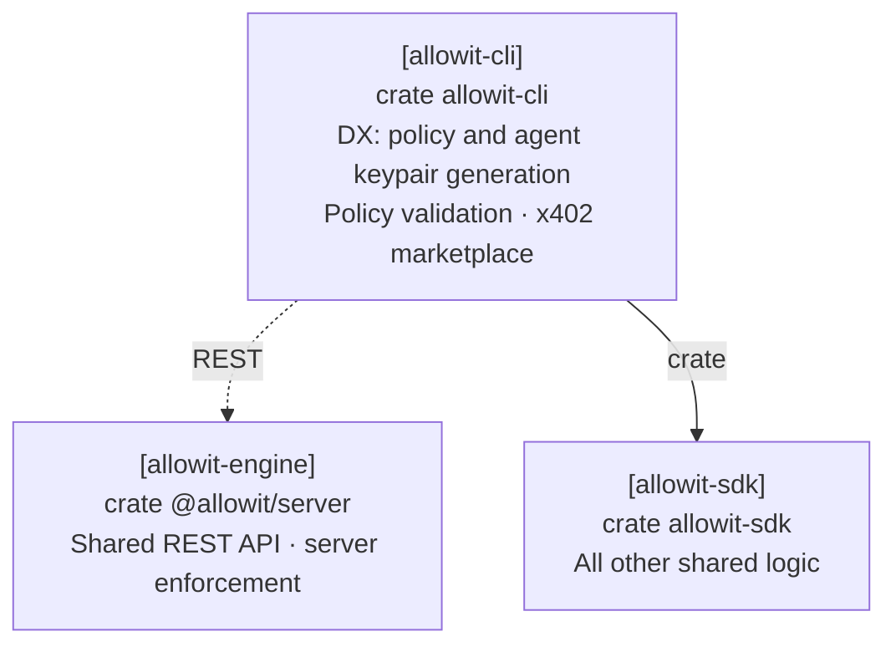

# Allowit CLI

The `allowit` command owns developer workflows, local key custody, portable drafts, wallet profiles and agent requests.
[`allowit-sdk-engine`](https://github.com/allowit-hq/allowit-sdk/blob/a2e50c4722fd82a7803c0bb1c78de5c2858a664f/engine/) supplies reusable workflows for CLI and server callers.
Rail core owns native encoding, signing, simulation and settlement semantics.
[Allowit core](https://github.com/allowit-hq/allowit-core) supplies deterministic policy logic and host transport and journal primitives.
The server supplies trusted policy enforcement and its own signing authority.
The CLI owns UX and client-side validation of selections, identities and requests, using shared Core and SDK logic.
Server enforcement and native chain authority remain with their respective components.

```sh
cargo run --locked --bin allowit -- --help
cargo build --locked --release --bin allowit
```

## Install

```sh
curl -fsSL https://raw.githubusercontent.com/allowit-hq/allowit-cli/main/install.sh | sh
```

[`install.sh`](../install.sh) installs `allowit` to `~/.local/bin` and prints the version with the build revision.
It takes a release binary when the GitHub release has one for the system, and checks its SHA-256 against the
release's `SHA256SUMS` file before it installs anything. Otherwise it says so and builds from source with cargo at
one exact commit. It installs Rust with rustup when cargo is missing, and as root on a system with `apt-get` the
missing build tools. A root shell without `~/.local/bin` on `PATH` gets a link in `/usr/local/bin`.
`ALLOWIT_INSTALL_DIR`, `ALLOWIT_VERSION`, `ALLOWIT_REF`, `ALLOWIT_FROM_SOURCE=1`, `ALLOWIT_NO_DEPS=1`,
`ALLOWIT_RELEASE_URL` and `ALLOWIT_DRY_RUN=1` change that; the script's header describes each one.
A release serves the installer with `allowit-<target>.tar.gz` for `x86_64-unknown-linux-gnu`,
`aarch64-unknown-linux-gnu`, `x86_64-apple-darwin` and `aarch64-apple-darwin`, each holding the `allowit` binary,
and one `SHA256SUMS` file.

## Agent start: `allowit POLICY_ID help`

The app gives the owner one line for the agent: an install URL and `allowit POLICY_ID help`.
The command reads the public facts of that policy from the server and prints the agent's next commands in order,
with the real values. `--json` prints the same as data.

```sh
allowit POLICY_ID help                                # the production server
ALLOWIT_URL=https://staging.example allowit POLICY_ID help
```

| State | What the command prints |
| --- | --- |
| `awaiting_agent_key` | `rail use`, `keys generate agent`, `keys use agent`, `keys fund agent` on a test network; then report the public key to the owner and run the command again |
| `draft` | The owner has the key and has not signed: wait and run the command again |
| `active` | The server key to compare with the app, then `rail use RAIL --rpc-url ENDPOINT`, `rail trust ORIGIN KEY`, `keys use NAME`, `wallet import --policy POLICY_ID`, `wallet use WALLET`; one example each of `exec`, `status` and `history`; the limits in the asset's unit |
| `inactive` | Ask the owner |

The command changes nothing. It pins no server key and imports no profile: the printed key is the server's own
claim, and the owner compares it with the key that the app shows under Agent access before the agent runs
`rail trust`. A device that holds no key for the policy's agent public key gets no setup and no payment command.
Every server value that enters a printed command is checked: an address of the rail, or a plain URL without a
character that a shell interprets. The command exits 4 with `policy_unknown` for an id that the server does not
have, and 7 when the server does not answer.
`wallet import --policy POLICY_ID` reads the same public profile from the server and verifies it as a file import
does: against the pinned server key and the rail's own endpoint. `rail use RAIL --rpc-url URL` keeps the endpoint
for that rail, so later commands need no flag.
[`skills/allowit/SKILL.md`](skills/allowit/SKILL.md) is the agent skill for the whole journey; `allowit guide`
prints it.

## Architecture

The CLI owns developer workflows for policies, agent keypairs, validation and the x402 marketplace.
It uses SDK engine for shared logic and the server REST API for server operations.



[Architecture](../README.md#architecture).

## Commands

```
allowit POLICY_ID help
allowit rail ls | show [RAIL] | use RAIL [--rpc-url URL] | trust ORIGIN PUBLIC_KEY
allowit keys generate NAME
allowit keys add NAME --public-key ADDR
allowit keys import NAME FILE|-
allowit keys use NAME
allowit keys ls | show NAME | fund NAME | export NAME | rm NAME
allowit config show | path
allowit wallet ls | show | use ADDR [--profile VERSION]
allowit wallet import PROFILE_FILE | --policy POLICY_ID
allowit wallet setup --owner-key NAME --agent-key NAME --server ADDR --request-id ID
allowit policy kinds [--server]
allowit policy generate --owner-key NAME --origin ORIGIN --kind native|simple|standard|custom (--new-wallet | --installation ID) PROMPT
allowit policy show [--source]
allowit policy check POLICY.rs [--compile]
allowit policy deploy DRAFT --owner-key NAME --origin ORIGIN --request-id ID --agent-key NAME --server ADDR --executable WASM --fee-limit FEE
allowit policy fund SELECTION --owner-key NAME --origin ORIGIN --request-id ID --amount AMOUNT --fee-limit FEE
allowit policy activate SELECTION --owner-key NAME --origin ORIGIN --request-id ID [--agent-key NAME --server ADDR]
allowit policy export SELECTION --owner-key NAME --origin ORIGIN --activation-id ID
allowit policy owner-status ID
allowit policy params show DOCUMENT
allowit policy params set DRAFT KEY VALUE [KEY VALUE]... --owner-key NAME --origin ORIGIN
allowit policy revise DRAFT --instruction TEXT --owner-key NAME --origin ORIGIN
allowit policy update WALLET KEY VALUE [KEY VALUE]... --owner-key NAME --origin ORIGIN --request-id ID --fee-limit FEE [--expected-revision N]
allowit policy verify WALLET --owner-key NAME
allowit policy export-pair DOCUMENT
allowit exec --op transfer --to DESTINATION --amount ASSET:5 --request-id pay-0001
allowit status pay-0001 --wait 60s
allowit history
allowit skills search QUERY | ls | show ENTRY
allowit call ENTRY|URL --max-price ASSET:AMOUNT
allowit curl URL --max-price ASSET:AMOUNT
allowit mcp
allowit completion --shell SHELL
allowit guide
allowit version
```

## Rails and build output

The CLI depends only on the AllowIt SDK and names no vendor. The [workspace manifest](../Cargo.toml) pins the SDK. The [lockfile](../Cargo.lock) fixes its source revision and the vendor plugins that it registers.
The [SDK plugin registration](https://github.com/allowit-hq/allowit-sdk/blob/main/crates/allowit-sdk/src/plugins/registered.rs) is the one place that lists vendor plugins. Each plugin supplies its network identities, aliases, assets and native behavior.
[`src/rails.rs`](src/rails.rs) is one generic adapter for every registered rail. It reaches each rail through the SDK registry.

```sh
allowit version
allowit rail ls --json
allowit rail show RAIL --json
```

`allowit version` and `allowit --version` print the release and the git revision that built the binary, as in `allowit 0.4.0 (d27da80d9671)`.
The revision is the short commit hash. It ends in `-dirty` when the working tree differed from that commit.
A build without a git checkout reads `ALLOWIT_BUILD_REVISION`, or reports `unknown`. `--json` prints `version` and `revision`.

Use the installed build's output instead of a copied rail list.
`rail ls` reports identifiers, aliases, family, Testnet status and the current selection.
`rail show` reports supported operations, available/unavailable commands, signing curve, asset metadata and local selections.
The selected rail's vendor plugin documents its public profile and native input formats.
Runtime configuration does not install another vendor.
Printed CLI examples use the effective selected rail, then the first rail in build order.
Reading help or the guide does not create settings or inspect private keys.

## Local keys and selections

The CLI stores wallet and key selections separately for each canonical rail identifier.
Private signing material remains in `secrets/NAME` with mode 0600 inside a 0700 directory.
`keys use` selects an existing private key for that network. It performs no server registration.
Public keys added with `keys add` cannot sign. `keys export` explicitly prints private signing material.

## Configure public server trust

Select a rail from `allowit rail ls --json` before configuring its backend identity.
Obtain the public identity through an independent trusted channel.
For a local server, derive it from the actual configured server signer through the launch setup.
A public profile or an unauthenticated discovery response cannot install its own trust anchor.

```sh
allowit rail use RAIL
allowit rail trust SERVER_ORIGIN PUBLIC_KEY
```

The command stores the public identity by rail and origin in `config.toml`, under `server_authorities`.
Repeating the same pin does not change the configuration. It does not create a key or change agent or wallet selection.
The origin must match `ALLOWIT_URL`. Credentials, paths, queries and fragments are not origins.
Imports and owner actions require this independent pin. Fresh execution retains that authority and one exact profile through journaling and signing.

## Generate an owner policy

Select the network and import the owner key by name. Generation does not change the selected agent key.
`ALLOWIT_URL` names the backend. `--origin` names an Origin that the backend allows for owner sign-in.

```sh
allowit rail use RAIL
allowit keys import owner owner.key
allowit --json policy generate --owner-key owner --origin http://localhost:5173 \
  --kind standard --new-wallet \
  'Pay only my approved recipient'
```

The shared SDK client validates the exact sign-in message before requesting an owner signature.
Its session stays in memory and is bound to that backend, Origin and owner account.
`--new-wallet` requires an advertised contract-wallet template. To use an existing owner installation,
replace it with `--installation ID` and that installation's kind. Selection never falls back between them.
`--kind` selects one of four wallet kinds. The SDK describes them, and each rail lists the kinds that it supports:

| Kind | Enforcement | Funds |
| --- | --- | --- |
| `native` | Allowit enforces the policy offchain | A keypair account |
| `simple` | Allowit enforces the policy offchain, as for `native` | A smart-contract wallet |
| `standard` | A smart-contract wallet enforces the standard policy onchain for the [supported params](https://github.com/allowit-hq/allowit-core/blob/main/README.md#standard-wallet-parameters) | The same wallet |
| `custom` | A custom contract, built from the policy source, enforces the policy onchain | The same contract |

`allowit policy kinds` prints each kind of the selected rail with its explanation, enforcement and custody, and for `standard` its supported params and their link.
`allowit policy kinds --server` reads `GET /api/wallet-kinds` and prints the kinds that the `ALLOWIT_URL` server accepts on the rail. `--json` prints the list as an array.
Kind ids are exact. A kind that the rail does not support exits 3 before any key or network access.
The CLI selects the rail's wallet profile for the kind. A rail can install `simple` and `standard` through one profile.
The draft's top-level `walletKind` names the kind that the server bound. The CLI does not print a draft of another kind (exit 3), and warns on stderr when a draft does not name its kind.
A server refusal such as `wallet_kind_unsupported` prints the server's code and reason and exits 4.
The complete prompt, selected network, profile and transfer operation go to the server.
Generated source starts its rule sequence with `allowit::operations`, binding the permitted operation set.
The [authoring contract](../docs/policy-reference.md#authoring-order) defines the order. UI renderers preserve it.

The result is a public portable draft with exact source and typed owner params. Exit 11 means that owner input remains unresolved.
Generation does not deploy, fund or activate a wallet. Its build report does not authorize publication.
After uncertain generation (exit 5), inspect the owner workspace before submitting another generation. The CLI sends no automatic retry.

## Execute and recover

Use `policy export` after activation, or `wallet import FILE --rpc-url URL` for a verified public export from another device.
Then inspect it with `wallet show` and `policy show`.
Each vendor plugin describes its public profile configuration and native request formats.
[Known issues](../known_issues.md) describes compatibility with older exports.
`ALLOWIT_URL` selects the server origin for owner requests and profile import. Without it the server is the
production origin, `https://app.allowit.xyz`; `config show` names the origin and whether it is the default.
The SDK retains that origin with each cached profile. Selecting an address does not fetch or import a profile.

Use only commands and operations advertised by `rail show`.
The CLI journals each operation before sending it. An uncertain result retains its request ID and exact bytes.
Repeat the same `exec` or read `status`. A new request ID represents a new operation.
Terminal status requires a verified receipt. A rotated agent key can recover an original receipt without a new operation signature.
`--wait DUR` bounds status polling only. Prepare and submit are not bounded.
When the server cannot resolve a request in one status read, the CLI reads the status again until the wait ends.
If the request is still unresolved then, the command prints the server's code and message, such as `operation_unresolved`, and exits 5. Read the same request ID again with `status`.
A refused request prints the server's code and message, such as `operation_refused`, and exits 4.

`exec` and `status` print the receipt of a settled request: the transaction hash, the `height` of its block or ledger,
the network `fee`, the moved `amount`, and the rail's `explorer` link when it has one.
When the result carries them, the receipt also shows `feeCharged`, the fee that counted against the spending limits,
and one row for each spending limit with its `limit`, `spent` and `remaining` amounts. `spent` includes fees.
For a keypair account `feeCharged` is the network fee. A contract wallet counts the fee that its transaction can be
charged: the rail simulates the operation and the server signs that fee before the wallet executes. It is at least the
network `fee`, and it is no longer the installed fee bound.
A limit for each payment, `payment_limit`, has no counter. `exec`, `status` and `wallet show` print it in the same table with `-` for `spent` and `remaining`.
JSON lists it under `paymentLimits` as `{param, limit}`, where `limit` is a quantity; `limits` holds only the limits that the rail counts.
`wallet show` reads the limits of the wallet from the server with the selected agent key, so a wallet that has made no payment shows its limits.
When the server cannot read the counters, `limits` is `null` in JSON and the text says so; the table never shows a zero that nothing counted.
When the server refuses the read, `wallet show` still prints the wallet, warns with the server's code and message, and prints no limit.
Every amount is a quantity `{units, asset, text}`. Text output prints `text`, which carries the asset's real unit.
`wallet show` and `policy show` include `walletKind`, the kind that the profile binds.
They print each param in human units, an amount with the unit of the installed asset. JSON keeps the stored `params` and adds `paramsDisplay` with each param's `label`, `shown` value and `unit`.
Original journal recovery does not require a new profile cache, current source approval or a new authority pin.
It queries the configured settlement service for the original packet and verifies its receipt. It never prepares another payment.

## Marketplace and paid calls

`skills`, `call`, `curl` (alias `http`) and `mcp` use one configured server, `ALLOWIT_URL`, and no other
service.

```sh
allowit skills search vault risk report      # search by meaning and keywords
allowit skills ls --limit 50                 # the catalog in id order
allowit skills show ENTRY                    # resource, methods, listed price
allowit call ENTRY --max-price ASSET:0.5     # pay what the seller asks, within the policy
allowit curl URL --max-price ASSET:0.5       # the same for any URL
```

The catalog is free to read. `skills search` prints how the server ranked the page on stderr: `hybrid`,
`semantic` or `keyword`. The selected rail keeps the entries whose seller accepts payment on it;
`--all-rails` lists every entry. Catalog text is listing data, and a listed price is indicative.

A paid call runs these steps:

1. The CLI requests the resource. A reply other than HTTP 402 is the result: nothing is paid.
2. On HTTP 402 the rail of the selected network reads the seller's payment challenge: the recipient, the
   amount, the asset and the challenge ID. The CLI prints the price with its unit on stderr.
3. The price must be at most `--max-price ASSET:AMOUNT`. Without `--max-price`, a seller that asks for
   payment is refused (exit 2). A higher price or another asset exits 9. Nothing is paid.
4. The CLI pays with the same path as `exec --op transfer`: the agent key signs, the policy decides and the
   server settles the transfer. A policy denial exits 20 and names the rule, such as `destinations` for a
   seller that the policy does not list, or `payment_limit`.
5. The CLI requests the resource once more with the proof of the settled payment and prints the resource.

The receipt of the payment prints on stderr, as `exec` prints it: the transaction, the ledger, the fee, the
counted fee and the limits. Stdout holds the resource alone: a pipe or a file gets its exact bytes, and a
terminal gets display controls escaped. `--json`
prints one document: `status`, `contentType`, `body` and `payment` with its `requestId`, `price` and
`receipt`. `-o FILE` writes the resource to a file; a resource that is not text needs it.

A call never pays twice. A request ID names one seller challenge and one seller request: the journal keeps
the challenge and a digest of the method, the URL, the headers and the body with the ID, and refuses another
request under the same ID. The CLI prints the request ID on stderr before it pays. After an interrupted call, or a seller that
did not deliver, run the command again with `--request-id ID`: it reads the settled payment and presents
its proof again. The server also pays one seller challenge ID once for a policy: it refuses a second request
ID for that challenge, and the CLI then reads the original request.

Exit codes of a paid call: 8 when the seller refused, failed or sent no usable challenge or resource; 9 when
the price is above `--max-price`; 20 when the policy denied the payment; 5, 7 and 12 as for `exec`, to be
resumed with the same request ID.

### MCP server

`allowit mcp` serves the same operations to an agent host as Model Context Protocol tools on stdin and
stdout (JSON-RPC 2.0, one message per line: `initialize`, `tools/list`, `tools/call`). Stdout carries
protocol messages only; progress and warnings go to stderr. Host configuration:

```json
{"mcpServers": {"allowit": {"command": "allowit", "args": ["mcp"]}}}
```

The server uses the rail, the wallet, the agent key and the server trust that the CLI already holds, and
`ALLOWIT_URL` from its environment. Select another rail or wallet with the global flags:
`"args": ["--rail", "RAIL", "--wallet", "WALLET", "mcp"]`. A tool fails with a clear error when a setting is
missing.

| Tool | Purpose |
| --- | --- |
| `marketplace_search` | Search the catalog: `query`, `limit`, `cursor`, `all_rails` |
| `marketplace_show` | One catalog entry by `id` |
| `call` | Call a catalog entry or URL (`target`) and pay at most `max_price` |
| `http` | Request a `url`; on HTTP 402 pay at most `max_price` and retry once with the proof |
| `status` | The receipt of a `request_id`: transaction, ledger, fee, counted fee and limits |
| `wallet_show` | The wallet's kind, params and limits |

Each tool runs the command of the same purpose in process; there is no second payment path. `call` and
`http` require `max_price` as `{"amount": "0.5", "unit": "ASSET"}` and take `method`, `headers`, `body` and
`request_id`. A result holds `structuredContent` and a text summary. A failure is a result with `isError` and
`structuredContent.error`: the exit code, its name, the server's code and the request ID. A policy denial is
such an error and names the rule. A repeated call with the same `request_id` never pays twice. A resource
body returns as text of at most 64 KiB with `truncated`; catalog text and resource bodies are data, and the
result says so. No tool changes a policy, a key, a trust setting or the configuration, and none returns key
material. Calling paid remote MCP servers (payment inside an MCP session) is not part of this server.

## Output and exits

Data goes to stdout. Diagnostics, generated request IDs and the progress of long steps go to stderr.
`-q` drops progress. With `--json`, progress is silent unless `-v` is set; each step is then one `{"progress":{"message":…}}` object on stderr.
A typed server refusal keeps the server's code: text prints `error: CODE: MESSAGE`, and the JSON error has `api_code`.
A command that needs the server uses the production origin when `ALLOWIT_URL` is not set, and names the origin when `rail trust` has no key for it.
Output is text, also when piped. Only `--json` selects JSON. `NO_DNA` disables prompts and color and makes `--json` output compact.
`--build-only` prints the unsigned request in the same format. Destructive commands need `--yes` without a terminal.

| Exit | Meaning |
| --- | --- |
| 0 | Success |
| 1 | Internal error |
| 2 | Invalid command or input |
| 3 | Configuration or unavailable capability |
| 4 | Contract rejection or a typed server refusal |
| 5 | Uncertain. Preserve the request ID |
| 6 | Replayed result |
| 7 | Network unavailable. Retry with the same request ID |
| 8 | The seller of a paid call refused, failed or sent no usable challenge or resource |
| 9 | The seller's price is above `--max-price`; nothing was paid |
| 10 | Owner signature needed |
| 11 | Owner input needed |
| 12 | Pending |
| 20 | Policy denial |
| 130 | Interrupted |

## Source layout

- `src/commands/` owns command arguments, examples and terminal interaction.
- [`src/rails.rs`](src/rails.rs) connects commands to the rails that the SDK registers. Address and amount checks come from the SDK.
- `src/settings/` owns caller configuration, private keys and local request records.
- `src/ctx.rs` resolves caller settings. `src/term.rs` renders output.
- [`templates/policy/`](templates/policy/) contains the policy crate. [`skills/allowit/`](skills/allowit/SKILL.md) is the agent skill: paying within a policy. [`skills/allowit-policy-authoring/`](skills/allowit-policy-authoring/SKILL.md) describes authoring.

Help snapshots live in `tests/snapshots/help/`. They show `<rail>` in place of each registered rail identifier.
Shared tests run once for each registered rail and take every address, asset and profile from the rail's fixtures. A rail skips a test of a feature that it does not serve.
After an intended command change, run `ALLOWIT_UPDATE_SNAPSHOTS=1 cargo test -p allowit-cli --test help`.

## Deploy, activate and export

Owner commands use an explicit named owner key. They do not change the selected agent key.
Pass an independent RPC endpoint with `--rpc-url URL`, or configure it for the selected rail.
Use stable request IDs to resume interrupted owner operations.

1. Generate and review the public policy draft.
2. For a contract wallet, supply the reviewed executable and run `policy deploy` with explicit agent and server addresses.
3. Run `policy fund` to fund the selected deployment.
4. Run `policy activate` for the exact source and parameters.
5. Run `policy export` with the completed activation ID. This saves the verified public profile locally and prints its public descriptor.
6. Select the agent key and wallet. Then use `exec` and `status`.

For account policies, configure native roles with `wallet setup` before activation.
The selected capability validates addresses, fee units, executable format and native signing intent.
Use each command’s `--help` for its required files and flags.
`policy owner-status ID` reads original owner receipts without the owner key or a new signature.
`policy deploy`, `policy fund` and `policy owner-status` print each owner transaction: its `action`, `transactionHash`, `ledger`, `status` and the rail's `explorer` link.
With `--json`, `policy deploy` and `policy fund` keep the document that the next owner command reads and list these facts under `receipts`.

Public profile versions are immutable. A new export does not replace a profile retained for historical status.
If several profiles match, use `wallet use ADDRESS --profile VERSION` to select one explicitly.
Imports never infer approved source from an address. Native imports validate portable administrator consent, the independent server pin and current native authority.

## Treasury workflow

A treasury owner delegates payments under a policy, changes its limits when obligations change and checks the
wallet on the ledger at each step. This section is the reference walkthrough. Each command works on every rail that
supports it; a rail without a step exits 3. `DRAFT` is the document that `policy generate` prints with `--json`.
`WALLET` is the document that `policy deploy`, `policy fund` or `policy update` prints with `--json`: each of them
selects the installed wallet for the next owner command.

```sh
# 1. Generate the treasury policy. Review its params in asset units and its two placements.
allowit --json policy generate --owner-key owner --origin ORIGIN --kind standard --new-wallet \
  'Let my agent pay the data vendor ADDRESS at most 1 per payment and 5 per day' > draft.json
allowit policy params show draft.json
allowit policy export-pair draft.json

# 2. Change typed values of the draft before you sign anything. The server checks each value.
allowit --json policy params set draft.json daily_spending_limit 3 \
  --owner-key owner --origin ORIGIN > draft-2.json

# 3. Deploy the reviewed wallet, fund it and verify it on the ledger.
allowit --rpc-url URL --json policy deploy draft-2.json --owner-key owner --origin ORIGIN --agent-key agent \
  --server ADDRESS --executable wallet.wasm --request-id deploy-0001 --fee-limit FEE --yes > wallet.json
allowit --rpc-url URL --json policy fund wallet.json --owner-key owner --origin ORIGIN \
  --request-id fund-0001 --amount 20 --fee-limit FEE --yes
allowit --rpc-url URL policy verify wallet.json --owner-key owner

# 4. Activate, export the public profile and let the agent operate within the policy.
allowit --rpc-url URL --json policy activate wallet.json --owner-key owner --origin ORIGIN --request-id activate-0001 --yes
allowit --rpc-url URL --json policy export wallet.json --owner-key owner --origin ORIGIN --activation-id activate-0001
allowit keys use agent && allowit wallet use WALLET_ADDRESS
allowit --rpc-url URL exec --op transfer --to ADDRESS --amount ASSET:0.2 --request-id pay-0001 --wait 5m

# 5. Change a value of the active wallet with one owner signature, then verify again.
allowit --rpc-url URL --json policy update wallet.json daily_spending_limit 1 --owner-key owner --origin ORIGIN \
  --request-id update-0001 --fee-limit FEE --yes > wallet-2.json
allowit --rpc-url URL policy verify wallet-2.json --owner-key owner
allowit --rpc-url URL --json policy export wallet-2.json --owner-key owner --origin ORIGIN \
  --activation-id update-0001 > profile-2.json
allowit --rpc-url URL wallet import profile-2.json
allowit wallet use WALLET_ADDRESS --profile VERSION
```

`policy params show` prints each param of a draft or wallet document in the unit of its asset.
`policy export-pair` prints the two placements of the policy: `host` is what the server evaluates before it signs,
the complete source with every rule, evidence function and param; `native` is what the wallet kind enforces on each
operation. A `native` or `simple` wallet enforces no rule itself, a `standard` wallet enforces the ordered standard
rules, and a `custom` wallet enforces its compiled source. Evidence functions always stay with the server.

`policy params set` takes each key with its value in human units, such as `3` for an amount of the asset or
`2026-12-31` for an expiry. The CLI parses the values before any key or network access, and the server checks them
again. `policy revise` sends one change in the owner's words; the model can change the source. Both print the next
draft and work only on an unsigned draft.

`policy update` changes values of an active wallet. The CLI reads the installed configuration revision through the
owner's RPC, reconstructs the exact update from `WALLET` and the new values, and signs the server's step only when it
is that update. The wallet keeps its recorded usage and its request nonce: an update neither raises nor resets what
the policy has spent. A request that the agent prepared before the update is stale; the agent sends it again.
Resume an interrupted update with the same `--request-id` and arguments: the CLI sends the saved signed step and
asks for no second signature. A resumed update keeps the values of its first run, also when a new expiry among
them has passed since: the server checks an expiry against its clock when it prepares a new step. `--expected-revision N` refuses the update when the wallet is at another revision.
The printed document selects the wallet with its new values, and its request ID exports the updated public profile
as an activation ID does. The profile cache then holds the profile from before the update and the updated one:
`wallet import` prints the `version` of the updated profile, and the agent selects it with
`wallet use ADDRESS --profile VERSION`. A typed server refusal, such as `param_out_of_range` or `update_unavailable`, exits 4.

`policy verify` reads the wallet through the owner's RPC, without the server and without a signature. It compares
`WALLET` with the ledger: the executable, the source binding, the rules, the params, the wallet kind, the owner,
agent and server, the asset and the policy instance. It prints each comparison and the state that it read: the
configuration revision, the pause flag, the installed params and the counters (`spentTotal`, `spentDaily`,
`spentDay`, `calls` and `nonce`). `countersFrom` is `ledger` when the wallet records its usage and `server` when the
server records it. The command exits 0 when every comparison matches and 5 when the ledger differs from the
document, for example when `WALLET` is the document from before an update.

## Owner capabilities and native policy binding

The shared Core admin traits describe deployment, pause and full-balance recovery capabilities.
Rail libraries prepare native arguments, trusted reads and unsigned transactions.
Preparation returns native transaction bytes and required authorizers. The caller reviews and signs the exact transaction.
SDK engine controls submission and original-hash recovery. Keys remain with the caller.

Portable policy source uses `pub fn execute(ctx: &AllowitContext) -> allowit::Result`.
Owner params supply configuration. Authenticated request facts and committed state come from the host and rail.
See the [portable policy reference](../docs/policy-reference.md) and the selected rail's vendor plugin.
